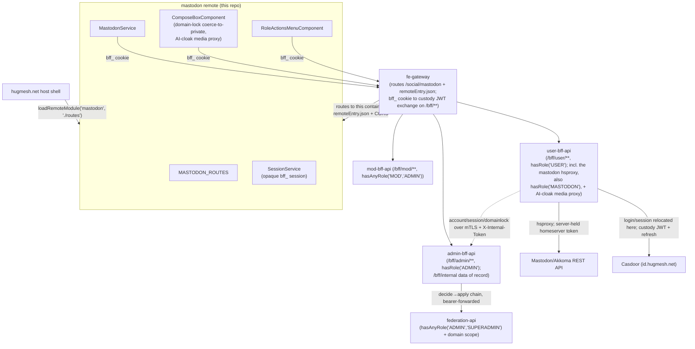
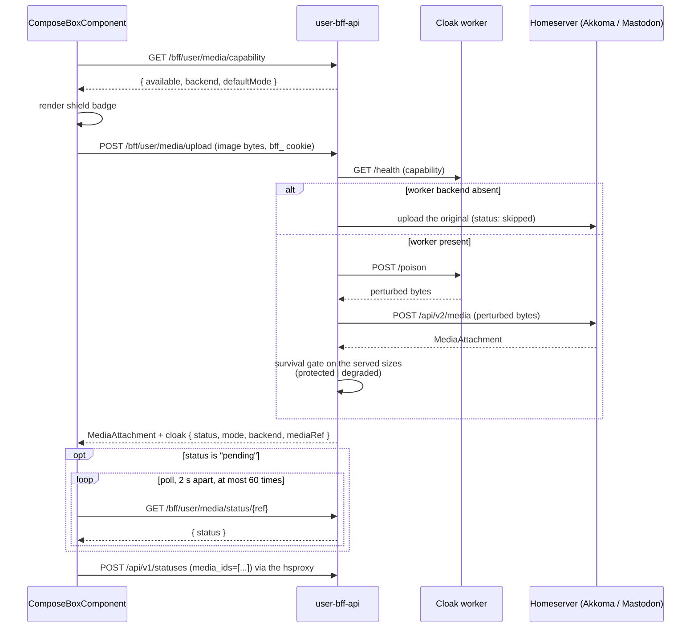

# hugmesh-mastodon-ui

This repo is the **Mastodon UI** — an Angular micro-frontend
([native-federation](https://www.npmjs.com/package/@angular-architects/native-federation)
**remote**) for the
[hugmesh.net](https://github.com/hugmesh/hugmesh-host-shell)
host shell. The host fetches and mounts this remote at runtime; the
`hugmesh-fe-gateway` (Spring Cloud Gateway) routes `/social/mastodon/**` to this
container (the route is rendered by hugmesh-generator,
`specs/cluster/apps/20-gateway-fe.yaml`, id `mastodon-ui`, `StripPrefix=2`).

**Mastodon or Akkoma?** This remote speaks the Mastodon client API, so it works
against either server. The cluster manifests deploy **Akkoma**
(`specs/cluster/apps/30-akkoma.yaml` in hugmesh-generator: "replaces Mastodon").
The local compose stack runs real **Mastodon v4.3.1** with `SOCIAL=1`
(`tests/stack/compose.real.yaml`) and adds **Akkoma v3.20.0** beside it with
`AKKOMA=1` (`Makefile`, `STACK_ALT_PROFILE`). The repo name says Mastodon; the
cluster server is Akkoma.

Part of the HugMesh RPi 5 / x86_64 cluster built by
[hugmesh-generator](https://github.com/hugmesh/hugmesh-generator).
The sibling remotes live in their own repos:
[matrix/social](https://github.com/hugmesh/hugmesh-matrix-ui) ·
[login](https://github.com/hugmesh/hugmesh-login-ui) ·
[user](https://github.com/hugmesh/hugmesh-user-ui) ·
[mod](https://github.com/hugmesh/hugmesh-mod-ui) ·
[admin](https://github.com/hugmesh/hugmesh-admin-ui).

## What this remote is

An Angular 22 + `@angular-architects/native-federation` single-project workspace.
Angular project name `mastodon`, root `.`, sourceRoot `src`, component prefix
`hug-mastodon`.

- **Remote name:** `mastodon`
- **Exposed federation module:** `./routes` → **`MASTODON_ROUTES`**
  (`src/app/mastodon.routes.ts`)

The host loads this remote at runtime via `loadRemoteModule('mastodon', './routes')`
and mounts the returned routes under `/social/mastodon`. The remote name
(`mastodon`) and the exposed key (`./routes`) are the stable public contract that
`loadRemoteModule()` depends on — never rename them without a coordinated host
update.

The shared federation surface (singleton libraries, `strictVersion` flags, the
RxJS skip list) is declared once in `federation-base.js` (`hugmeshRemote()`),
which is copied verbatim from the `hugmesh.net` reference. This keeps all
remotes in sync with the host; `federation.config.js` in this repo only declares
the remote name and `exposes` — it does not redefine shared libraries.

```js
// federation.config.js — the only repo-specific federation concerns
const { hugmeshRemote } = require('./federation-base');

module.exports = hugmeshRemote({
  name: 'mastodon',          // stable — matches the host's loadRemoteModule() call
  exposes: {
    './routes': './src/app/mastodon.routes.ts',  // stable — the federation contract
  },
});
```

`src/app/app.component.ts` (`hug-mastodon-root`) is a minimal standalone dev
shell used only when running this remote in isolation (`ng serve mastodon`). In
production the host federates `./routes` directly and the shell component is
never loaded.

### Architecture & data flow

The host federates `./routes`; the fe-gateway routes `/social/mastodon/**` to
this container **and** proxies every same-origin `/bff/**` call to the BFF
services (`/bff/mod/**` to mod-bff-api, `/bff/user/**` to user-bff-api, the rest
to admin-bff-api). On the way it turns the browser's opaque `bff_` session cookie
into the internal Casdoor custody JWT — see
[Auth, session & role-gate](#auth-session--role-gate). Since the **D6
BFF-proxy cutover** (now the default), `MastodonService` itself talks to
`user-bff-api`'s `MastodonProxyController` hsproxy (`/bff/user/mastodon/...`)
rather than to the Mastodon homeserver directly; the hsproxy owns the upstream
homeserver token server-side and forwards the native `/api/...` path verbatim
to the `akkoma-proxy:4443` mTLS sidecar. The hsproxy needs `hasRole('MASTODON')`
on top of the `ROLE_USER` floor:



The browser only ever holds the **opaque `bff_` session cookie**; the
fe-gateway swaps it for the internal Casdoor custody JWT before forwarding to
whichever BFF owns the path, and each BFF enforces its own
`hasRole`/`hasAnyRole` gate (see
[Auth, session & role-gate](#auth-session--role-gate)). The remote never sees a
raw Casdoor or per-service token.

## Routes / key components

All routes are children of `MASTODON_ROUTES`, mounted by the host at
`/social/mastodon/...`:

| Path | Component | Notes |
| --- | --- | --- |
| `''`, `home` | `MastodonTimelineComponent` | home timeline + top composer |
| `local` | `MastodonTimelineComponent` | `data.source: community` (local public) |
| `public` | `MastodonTimelineComponent` | federated public |
| `tags/:tag` | `MastodonTimelineComponent` | hashtag timeline |
| `favourites`, `bookmarks` | `MastodonTimelineComponent` | Link-header paginated |
| `lists/:id` | `MastodonTimelineComponent` | list timeline |
| `status/:id` | `StatusDetailComponent` | single status + ancestor/descendant context |
| `account/:acct` | `AccountProfileComponent` | profile + that account's statuses |
| `notifications` | `NotificationsColumnComponent` | |
| `search` | `SearchComponent` | accounts / statuses / hashtags |
| `explore` | `ExploreComponent` | trending statuses / tags / links |
| `direct` | `ConversationsColumnComponent` | DM conversations |
| `lists` | `ListsIndexComponent` | the caller's lists |

`MastodonTimelineComponent` is reused across the home, local, public, hashtag,
list, favourites, and bookmarks routes. The route's `data.source` field (plus the
`:tag` / `:id` path params) tells the component which timeline to fetch, so only
one component handles all seven views.

Key supporting components:

- `TootCardComponent` — renders a single status with reply / boost / favourite /
  bookmark actions, content-warning expand, media, and an embedded `PollComponent`.
- `ComposeBoxComponent` — the post composer, also used inline for replies.
- `RoleActionsMenuComponent` — the role-tiered moderation menu (see [Role-tiered action surface](#role-tiered-action-surface)).
- `AppearancePanelComponent` — per-user appearance settings (see [Appearance / style preferences](#appearance--style-preferences)).

Remote/federated HTML (toot content via `safeContent()`, profile bio + fields via
`safe()`) is first run through DOMPurify's allow-list (`sanitizeContentHtml()` in
`src/app/html-sanitize.ts`: no script/iframe/svg tags, no `on*` attributes,
http(s)-only URLs, `rel="noopener noreferrer"` forced on `target` links). The
resulting string is then bound through Angular's `[innerHTML]` **with the
built-in sanitizer left on** as a second gate; nothing calls
`bypassSecurityTrustHtml`. Injected `<script>` / `on*` handlers / `javascript:`
URLs are stripped while safe formatting markup is kept (stored/DOM XSS, A03 /
CWE-79). ✅ shipped.

`MastodonService` (`src/app/mastodon.service.ts`) is a thin, typed wrapper over
the Mastodon REST API, covering timelines, statuses and context, post /
favourite / reblog / bookmark, polls, media, notifications, accounts and
relationships, search, favourites, bookmarks, lists, conversations, and trends.
By default every request goes same-origin to the user-bff hsproxy at
`${__HUG_BFF_URL__}/bff/user/mastodon` (`MASTODON_PROXY_MODE`, default `true`;
the runtime global `__HUG_MASTODON_PROXY_MODE__` overrides it). The runtime
global `__HUG_MASTODON_URL__` (default `https://mastodon.hugmesh.net`) is read
only when proxy mode is off. That legacy path calls the homeserver directly with
no `Authorization` header, so it works for public, read-only diagnostics and
nothing else.

## Auth, session & role-gate

Login/registration happen entirely in the **login** remote's own native form,
which POSTs credentials to its own BFF's login endpoint; Casdoor
(`id.hugmesh.net`) is **internal-only** and never redirects the
browser — there is no OAuth2/OIDC authorization-code browser redirect anywhere
in this flow. **`hugmesh-user-bff-api`** authenticates the submitted
credentials against Casdoor server-side and holds the per-session Casdoor JWT
custody + refresh. The browser — and therefore this remote — only ever holds
an **opaque `bff_`-prefixed session**; the user never sees their own Casdoor
JWT, and there is no per-service Mastodon token in the browser. This remote
never renders a login form.

- `MastodonService` and the BFF services attach the shared opaque `bff_` session
  as a same-origin cookie (`withCredentials`/`credentials: 'include'`), never as
  an `Authorization` header. The cookie is named `bff_session`; its value starts
  with `bff_`.
- Two filters in the shared `hugmesh-gateway` image (which the fe-gateway
  reuses) do the swap, both behind `hugmesh.gateway.bff-exchange.enabled` (the
  cluster manifest sets it): `BffCookieToBearerWebFilter` copies the cookie into
  `Authorization: Bearer bff_…`, and `BffJwtExchangeWebFilter` swaps that bearer
  for the custody JWT by asking admin-bff over mTLS plus an internal token. A
  failed swap is a 401; the raw `bff_` value is never forwarded. Each BFF
  (`user-bff-api`, `mod-bff-api`, `admin-bff-api`) then enforces its own
  `hasRole`/`hasAnyRole` gate. Each BFF can also resolve a raw `bff_` session
  itself (user-bff `BffSessionAuthenticationWebFilter`; mod-bff and, via
  `hugmesh-auth-core`, admin-bff each have a `BffCookieAuthenticationWebFilter`),
  so none of them is a pure JWT resource server.
- The host injects nothing service-specific; a host may still call
  `setAccessToken()` only as a standalone-dev no-op override (see
  `MastodonService.setAccessToken`).

> Auth-core extraction is complete: user-bff performs the native-login
> credential check against Casdoor server-side (no browser redirect) and holds
> the per-session Casdoor custody JWT + refresh. The account/session **data of
> record** lives in `admin-bff-db`;
> user-bff reaches it via `admin-bff` `/bff/internal` over mTLS +
> `X-Internal-Token`. The shared `hugmesh-auth-core` Maven artifact carries the
> common session/MFA/Casdoor-admin infrastructure. This remote only ever talks to
> the fe-gateway (which forwards to the BFF services) and is unaffected by where
> the BFF logic lives.

`SessionService` (`src/app/session.service.ts`) is the canonical HugMesh
session store. It holds the `HugSession` and derives the Casdoor role tiers as
signals — `isUser` (any authed user), `isMod` (`mod` **or** `admin`), `isAdmin`
(`admin` only) — plus `fullyRegistered`. Each remote and the host hold their own
`SessionService` over the same shared session and re-read on a same-document
broadcast / cross-tab `storage` event, so completing registration in the login
remote unlocks the host shell's social nav.

These role signals are **defence-in-depth**: the bff-apis enforce
`ROLE_USER`/`MOD`/`ADMIN` server-side (and the gateway runs the data-driven
`gateway_route_access` gate — ADMIN/GAME-MASTER bypass within own domain,
SUPERADMIN cross-domain), and the UI simply never shows an option the role can't
use. The additive tiers preserve the invariant that a MOD never sees the ADMIN
tier and a USER never sees the MOD/ADMIN tier.

### Role-tiered action surface

`RoleActionsMenuComponent` (element `hug-mastodon-role-actions`, mounted from
both `TootCardComponent` and `AccountProfileComponent`) is a single reusable
menu that renders additive tiers based on the session role signals:

| Tier | Signal | Actions | BFF |
| --- | --- | --- | --- |
| USER | `isUser` | self-block an account (`POST/DELETE /bff/user/blocks`); recommend instance block to mods (`POST /bff/user/recommend-instance-block`) | `UserBffService` |
| MOD | `isMod` | server-wide block of a user or instance (`POST /bff/mod/block`); triage moderation queue (`GET /bff/mod/moderation`); refer case to admin (`POST /bff/mod/moderation/{id}/refer`) | `ModBffService` |
| ADMIN | `isAdmin` | approve / deny a referred moderation request (`POST /bff/admin/moderation/{id}/decide?approve=<bool>`) — wired to `admin-bff-api`'s decide→apply chain, which bearer-forwards to `federation-api`'s own `hasAnyRole('ADMIN','SUPERADMIN')` + per-domain scope check; an approved `user-removal` auto-applies a kill-switch override, a denied re-decision rearms it. A failed decide surfaces an alert and is NEVER treated as applied. The full Mastodon admin console still lives in `hugmesh-admin-ui` by design — this menu only covers the decide step of the USER→MOD→ADMIN referral chain. | `AdminBffService` |

A MOD sees the USER tier plus the MOD tier. An ADMIN sees all three tiers,
including the wired decide action.

### SOCIAL local-only / domain-lock ✅ shipped

When an admin/mod domain-locks an account, the homeserver's **force-local MRF is
the actual enforcer** — the UI is honest defence-in-depth on top of it, never the
source of truth.

`SessionService.mastodonDomainLocked` is a computed signal off a
`MASTODON_DOMAINLOCKED` role marker that the BFF tier forwards (domainlock
pass-through; the account/domainlock data of record lives in `admin-bff-db`,
surfaced into the session via the user-bff/gateway path). The marker is
normalised before it is read: a `ROLE_MASTODON_DOMAINLOCKED` / mixed-case variant
is lowercased to `mastodon_domainlocked` (the same reserved-prefix-aware folding
the rest of the session roles use), so the lock survives prefix/case differences
across BFFs.

In `ComposeBoxComponent`, a domain-locked user (`domainLocked()` true):

- has the **federated-reach visibilities** (`public`, `unlisted`) disabled +
  helptext'd in the visibility picker, with the local-only indicator shown as
  enforced (`aria-disabled` so it stays focusable, not natively `disabled`);
- has the visibility **coerced down to `private`** whenever the chosen value is
  federated (e.g. a `defaultVisibility` Input, or a cross-tab lock that lands
  after the composer opened). The rendered `visibility` is a `computed` signal
  over the user's raw choice, so the picker updates without a check-loop pass;
  `submit()` applies the same `localSafe()` rule **again** as a second
  defence-in-depth layer even if the bound value was somehow set past the
  disabled UI.

The non-locked case is left honest too: a per-post local-only toggle is *not*
wired (no per-post local-only flag on the homeserver yet), so the control shows
"not available yet" copy rather than pretending to work.

## BFFs & multi-tenancy

The remote talks to three same-origin BFF APIs that the fe-gateway proxies. The
base URL defaults to the same origin and can be overridden via
`__HUG_BFF_URL__`:

- `UserBffService` → `/bff/user/**` (hugmesh-user-bff-api, `hasRole('USER')`):
  self-blocks and instance-block recommendations. The user-bff-api pins `owner`
  to the JWT subject on every query, so a user can only read or modify their own
  rows — no server-side enforcement is needed in the UI. The same service also
  hosts the `mastodon` hsproxy (`MastodonService`'s default transport) and the
  AI-cloak media proxy.
- `ModBffService` → `/bff/mod/**` (hugmesh-mod-bff-api): the moderation queue
  and server-wide blocks, gated server-side by `hasAnyRole('MOD','ADMIN')`.
- `AdminBffService` → `/bff/admin/**` (hugmesh-admin-bff-api,
  `hasRole('ADMIN')`): approve/deny a referred moderation request. Bearer-
  forwards the caller's identity to `federation-api`'s own
  `hasAnyRole('ADMIN','SUPERADMIN')` + domain-scope check, so this remote never
  authorises a decision on its own, only relays it.

All three follow the HugMesh datastore pattern (RxJS `BehaviorSubject`-backed,
single source of truth where there's a cached collection) and attach the shared
opaque `bff_` session as a cookie (`withCredentials`/`credentials: 'include'`);
the fe-gateway derives the bearer server-side, so the browser never holds one.
Because the gateway resolves the BFF target per request and the BFFs key every
row to the authenticated JWT subject (issuer-keyed domain scoping), the same
federated bundle serves every brand/tenant — the remote carries no per-tenant
config.

### AI-cloak media (poison-before-ingest)

When the composer uploads an **image** with the per-user AI-cloak preference ON,
it routes the file through the BFF media proxy
(`POST /bff/user/media/upload`, authed with the `bff_` session) so the bytes are
Glaze/Nightshade-style perturbed **before** the homeserver ingests / re-encodes /
federates them — a direct `/api/v2/media` upload would let the clean original
federate first. The BFF returns the homeserver `MediaAttachment` exactly as a
direct upload would (downstream `submit()` / `media_ids` is untouched) plus a
server-owned `cloak` decision.



The composer checks `GET /bff/user/media/capability` when it opens so the shield
state is shown immediately, before any file is chosen. In the pipeline above the
BFF, not the worker, uploads the perturbed bytes, and the upload response
already carries the final status. The per-attachment badge polls
`GET /bff/user/media/status/{ref}` only when that status is `pending`, and the
user can press "post without protection" to stop waiting (the badge then reads
`skipped`).

The UI copy is deliberately honest: it never displays "protected" for a
`degraded` / `skipped` / `unavailable` / `failed` outcome. When the heavy worker
tier is absent (for example on a Pi5-only cluster, where the worker pod stays
`Pending`), a warning appears before the user posts so they can choose to
continue without protection.

## Appearance / style preferences

Every signed-in user (user / mod / admin) can customise **their own** look
through the timeline-header gear icon (`AppearancePanelComponent`). Available
options, modelled on the spirit of TangerineUI for Mastodon with no CSS
copied: colour theme and accent, light / dark / auto mode, single vs multi
column, density, media corner style, font family (including a dyslexia-friendly
option), text size, high-contrast mode, and reduced-motion toggle.

`PreferencesService` is the single source of truth for these settings. Every
change flows through a single `set()` → `persist()`/`pushUserPref()` chokepoint:
it applies **immediately and locally** (never blocked on the network) — saved
to a versioned localStorage key (`hug.mastodon.prefs.v1`) and applied as
`data-*` attributes and CSS custom properties **scoped to this remote's own
root** (`.hug-mastodon` / `hug-mastodon-root`, preventing leakage onto the
host shell or sibling remotes) — and is also synced **durably** to the caller's
account via `PUT /bff/user/preferences` in the background; a failed durable
write is never a silent no-op, it surfaces on `PreferencesService.syncError()`
so the panel can tell the user the change may not follow them to another
device. On load, the resolved order is: built-in default ← the org/admin
default (`GET /bff/mastodon/appearance-default`, falling back to the shipped
`assets/mastodon-appearance-default.json` asset only when no admin-bff default
is configured yet or the fetch fails) ← the caller's own saved prefs
(`GET /bff/user/preferences`, server value wins over the localStorage cache).
The OS `prefers-reduced-motion` and `prefers-contrast` media queries are read
on first load and used as defaults before the user sets their own preference.

An ADMIN-only control ("set as the default for everyone",
`PreferencesService.setOrgDefault()`) applies + caches the new default locally
immediately (so the admin sees it take effect right away and it survives an
offline reload) and pushes it durably via
`PUT /bff/admin/mastodon/appearance-default` (`admin-bff-api`,
`hasRole('ADMIN')` server-side) in the background; the same honest
`syncError()` surfacing applies if that write fails. The chat-theme group is
stripped out of the org default at this chokepoint — chat styling is
personal-only by design (see [Chat theming](#chat-theming)) and can never
become the org default.

## Voice & video messages, VN chat mode & chat theming

### Voice & video messages

`ComposeBoxComponent` can record a voice (mic) or video (camera + mic, capped
at 720p) message in place, via `MediaRecorderService`
(`src/app/media-recorder.service.ts`) — a `getUserMedia` + `MediaRecorder`
wrapper that is **component-provided on purpose**: every composer (including
each inline DM reply composer) owns its own instance, so one composer's
recording never bleeds into another and Angular tears the mic/camera down with
the component. A recording is hard-capped at five minutes: at 300 s the take is
**finalised** exactly as if the user pressed Stop, never silently discarded.
The finished take previews locally (an object URL, revoked on
attach/discard/destroy), and Attach feeds the recorded `File` through the
**same** ingest path a picked file uses — `MastodonService.uploadMedia`
(`POST /api/v2/media`, through the hsproxy); the AI-cloak route is image-only and
never sees it. A take over 64 MiB is refused in the browser before upload.
Playback on the receiving side needed no new code: `TootCardComponent` already
renders `<audio>` / `<video>` attachments. Fail-soft throughout: a browser
without `MediaRecorder`/`getUserMedia` hides the record buttons entirely
(never a dead control), and permission refusal / device failure surfaces as an
honest status line while the composer stays fully usable.

### VN chat mode

Each conversation on the `direct` route can be swapped **in place** into a
visual-novel presentation and back, via its per-conversation "VN mode" toggle
(`ConversationsColumnComponent` → `hug-mastodon-vn-chat`, `src/app/vn/`): a
flat-vector scene background + on-stage prop layer, participant "sprites"
(framed avatars with name plates; the current message's sender lit, the others
dimmed), and a classic dialogue box that walks the thread one message at a
time (Prev / Next / Latest, opening on the newest). The thread is fetched the
way the app already can — the conversation's `last_status` plus
`GET /api/v1/statuses/{id}/context` — and replying uses the same
direct-visibility `hug-mastodon-compose-box` (voice/video messages included).
Scenes and props are **shipped local assets only** (`SceneService` over the
schema-versioned `assets/vn/scenes/scenes.json` manifest — no federated bytes
ever reach the stage), and message bodies pass through the exact DOMPurify +
Angular-sanitizer gate `toot-card` uses, so VN mode widens no federated-HTML
surface. The typewriter text reveal is skipped under reduced motion. The
embedded scene/prop picker persists per user through `PreferencesService`
(keys below).

### Chat theming

The appearance panel gains a **Chat** section — personal-only by design:
`setOrgDefault` strips the whole group, so a user's (or admin's) chat styling
can never become the org default. Options: bubble shape, your/their bubble
accent colours (strict `#rrggbb`, validated before a value can ever reach a
CSS-var write), chat font, chat density, background pattern, and the VN
dialogue-box skin — plus a live bubble preview and a chat-only reset. Every
choice flows through the same `PreferencesService` chokepoint as the rest of
the appearance group: applied as `data-mastodon-chat-*` attributes +
`--mastodon-chat-*` CSS custom properties scoped to this remote's root,
persisted to `hug.mastodon.prefs.v1`, and synced best-effort via
`GET`/`PUT /bff/user/preferences` under the durable keys:

| Field | Durable key | Values |
| --- | --- | --- |
| `chatBubbleShape` | `mastodon.appearance.chat.bubbleShape` | `rounded` (default) / `square` / `sharp` |
| `chatAccentMine` | `mastodon.appearance.chat.accentMine` | `#rrggbb`, or `''` = unset (default) |
| `chatAccentTheirs` | `mastodon.appearance.chat.accentTheirs` | `#rrggbb`, or `''` = unset (default) |
| `chatFont` | `mastodon.appearance.chat.font` | `system` (default) / `serif` / `rounded` / `mono` |
| `chatDensity` | `mastodon.appearance.chat.density` | `cozy` (default) / `compact` |
| `chatBackground` | `mastodon.appearance.chat.background` | `none` (default) / `dots` / `lined` / `stars` |
| `vnDialogSkin` | `mastodon.appearance.chat.vnDialogSkin` | `classic` (default) / `glass` / `retro` |
| `chatVnScene` | `mastodon.appearance.chat.vnScene` | a scene id from `assets/vn/scenes/scenes.json` (default `vn_scene_bedroom`) |
| `chatVnProps` | `mastodon.appearance.chat.vnProps` | comma-joined prop ids, `''` = none (default) |

The `.vn-dialog` class (with `.chat-surface`, `.chat-bubble`,
`.chat-bubble--mine`, `.chat-bubble--theirs`) is the **only** selector contract
between the VN view / chat surfaces and the preference SCSS in
`src/styles.scss`. High-contrast mode always beats the decorative skins and
accents, and with the built-in defaults the rendered look is exactly the
pre-theming one. E2E coverage (Gherkin plus real step-definitions) exists under the `@cluster`
tag (`e2e/features/social/voice-video-messages.feature`,
`e2e/features/social/vn-chat-mode.feature`); a no-filter `bddgen` passes for
both, but they remain `@cluster`-gated pending verification against a live
stack.

## Accessibility conventions

This remote follows the cross-repo HugMesh a11y standard. The baseline rules
are included in `src/styles.scss`, making the remote accessible both when run
standalone and when federated into the host:

- The `.sr` screen-reader-only helper carries text labels alongside icon-only
  controls; decorative emoji/icons are `aria-hidden="true"`.
- Async results announce through live regions — `role="status"`/`aria-live`
  (`polite`) for normal updates, `role="alert"`/`assertive` for errors; the
  appearance panel and role-actions menu announce each applied change.
- Toggle controls expose state via `aria-pressed` / `aria-expanded`; pop-over
  panels trap focus on open, restore it to the trigger on close, and close on
  `Escape`.
- Composer fields use unique `<label for>` bindings (per-instance id prefixes so
  inline reply composers stay unique) and a live character counter.
- WCAG-AA/AAA `--hug-*` colour tokens, a touch-target minimum, and a
  reduced-motion media query are baked into the baseline styles.
- Full **keyboard operability** ✅ shipped: native buttons/inputs/selects
  throughout; the account-profile tabs are a WAI-ARIA `tablist` with a roving
  `tabindex` driven by `ArrowLeft` / `ArrowRight` / `Home` / `End`
  (`onTabKeydown`); the compose "Attach media" file input is visually hidden but
  kept **in the tab order** (`.sr`, not `hidden`) so it stays focusable; and the
  dev shell provides a skip link to a focusable `<main>` landmark, backed by a
  global `:focus-visible` ring.

## Known Gaps / TODO

These are the unfinished or intentionally-stubbed pieces of this remote,
verified against the current code (not aspirational):

- **Server-wide block's external homeserver-admin call is STUBBED server-side** —
  `ModBffService.block()` (`POST /bff/mod/block`) always writes the local audit
  row, but the `external` field in the response can come back `'stubbed'` or
  `'degraded:…'` rather than `'ok'` (the BFF answers `202` pending-reconcile
  then); the UI surfaces whatever the BFF reports honestly rather than assuming
  success (`ModBlockResult` and `block()` in `src/app/mod-bff.service.ts`).
- **The server-wide block has a step-up (MFA) gate this remote does not handle** —
  mod-bff-api guards `POST /bff/mod/block` with `ModStepUpGate`; a refusal is a
  `403` with an `X-Mod-StepUp` header. The gate ships dark
  (`app.mfa.enforce-sensitive-writes`, default `false`). Nothing in `src/app`
  reads the header or starts a step-up challenge, so once the gate is armed the
  menu shows its generic failure message.
- **User self-block's external push can also be `'stubbed'` or `'n/a'`** —
  `UserBffService`'s `BlockAck.external` is a free-form status string
  (`'live' | 'stubbed' | 'n/a'`), not always `'live'`
  (`BlockAck` in `src/app/user-bff.service.ts`).
- **Appearance/preference syncs (both the caller's own prefs and the ADMIN
  org-default) are best-effort/non-blocking, not transactional** — `set()` and
  `setOrgDefault()` apply + cache locally IMMEDIATELY, then push durably to
  `PUT /bff/user/preferences` / `PUT /bff/admin/mastodon/appearance-default` in
  the background (`pushUserPref`/`pushOrgDefault` in
  `src/app/preferences.service.ts`); a failed durable write is never a silent
  no-op — it surfaces on `PreferencesService.syncError()` — but it also never
  blocks or retries automatically, so a value can still drift per-browser/
  per-device until the next successful write.
- **Notification refresh is a 30s POLL, not a live push** —
  `NotificationsColumnComponent` now refreshes itself on a timer (see Current
  State), so a mention that lands while the column is open appears within 30
  seconds without any user action. It is still not real-time: the homeserver's
  native streaming API would be (see Roadmap). Two consequences of the poll
  being incremental (`min_id`, prepend-only, so the user's "Load more" pages
  survive): the column only ever looks UPWARD, so a notification dismissed in
  another session is not reconciled away here until something triggers a full
  `reload()`, and a burst of more than one page between ticks is caught up over
  the following ticks rather than all at once.
- **The AI-cloak status key differs between server and UI (read, not run)** —
  user-bff-api names the key `mediaRef` (`MediaPoisonDecision`, and the `cloak`
  block `MediaPoisonController` adds to the upload response); this remote's
  `CloakResult` reads `ref`. The upload already returns the final status, so the
  badge does not need the poll today, but a `pending` upload could not be polled.
- **Per-post local-only posting is honestly unavailable for non-domain-locked
  accounts** — `ComposeBoxComponent`'s local-only toggle stays `aria-disabled`
  outside the domain-locked (forced) case: the standard Mastodon visibility enum
  has no per-post local-only flag and no BFF endpoint accepts one, so the control
  discloses "not available yet" rather than acting (the `local-only-toggle`
  button in `src/app/compose-box.component.html`).

## Current State

- **Stack:** Angular 22 + `@angular-architects/native-federation` 22; native-
  federation **remote** `mastodon` exposing `./routes` → `MASTODON_ROUTES`,
  federated by the host shell at `/social/mastodon`. Requires Node `^22.22.3 || ^24.15.0 || >=26.0.0` (Angular CLI 22 engine constraint).
- **Optional service:** this remote is the UI for the **Akkoma/Mastodon** optional
  service: the cluster deploys Akkoma, the compose stack runs Mastodon (see the
  top of this file). It degrades gracefully (greyed-out / honest "not available"
  copy) when the homeserver, the worker tier, or a backing BFF endpoint is absent.
- **Auth:** native-login via the login remote's own form (POSTs credentials to
  its BFF; Casdoor is internal-only and never redirects the browser); user-bff
  does the server-side credential check and holds the per-session Casdoor JWT.
  The browser holds only the **opaque `bff_` session cookie**; the fe-gateway
  exchanges it for the custody JWT (`BffCookieToBearerWebFilter` +
  `BffJwtExchangeWebFilter`, see [Auth](#auth-session--role-gate)) before
  forwarding to whichever BFF owns the path, and each BFF
  (`user-bff-api`/`mod-bff-api`/`admin-bff-api`) enforces its own role gate. The
  remote renders no login form.
- **Shipped:** native-federation remote + UI standard adoption; full route surface
  over a typed `MastodonService` (routed through the user-bff-api hsproxy by
  default); DOMPurify + Angular-sanitizer XSS hardening (no
  `bypassSecurityTrustHtml`); live home-timeline posts over the streaming SSE
  (`MastodonStreamService`, home source only) and a client-connect banner that
  shows an instance URL for the user's own Mastodon client, only after the
  instance answers a real `/api/v1/instance` request for a holder of
  `ROLE_MASTODON_EXTERNAL_CLIENT`;
  USER/MOD/ADMIN role-tiered action surface incl. the ADMIN approve/deny decide
  wired to `admin-bff-api`; SOCIAL local-only / domain-lock coerce-to-private in
  the composer; AI-cloak poison-before-ingest media proxy; per-user
  appearance/style preferences durably synced via `/bff/user/preferences` +
  an ADMIN org-default synced via `/bff/admin/mastodon/appearance-default`
  (both real admin-bff-api endpoints, with a localStorage cache + a shipped
  asset as the offline/unconfigured fallback); cross-repo a11y baseline + full
  keyboard operability; voice/video DM messages, a per-conversation VN chat
  mode, and chat appearance theming; baseline nginx HTTP security headers incl.
  a strict per-response nonce-based CSP with no `script-src unsafe-inline`
  (see "Deploy" below); Playwright +
  BDD/Gherkin e2e harness (ships dark); GitLab CI build+push + OWASP pentest
  stage (SCA + authenticated ZAP/nuclei baseline).
  `NotificationsColumnComponent` loads on mount and on filter-switch /
  load-more / dismiss / clear-all, **plus a 30s background refresh** that asks
  only for what is newer than the top item (`min_id`) and prepends it, so
  already-loaded pages and scroll depth survive; it never sets `loading`, is
  skipped entirely while the tab is hidden (and fires once on return), and its
  interval is registered outside the Angular zone so `ApplicationRef.isStable`
  is unaffected (see [Known Gaps](#known-gaps--todo)).
- **CI/CD:** GitLab is the pipeline (the GitHub repo is pull-mirrored into
  in-cluster GitLab). `.gitlab-ci.yml` builds + pushes the nginx image to the
  in-cluster registry and `include`s the centralized generator pentest templates;
  deployed to `hugmesh-frontend` and fronted by the fe-gateway. ArgoCD GitOps.
  GitHub has one workflow, `.github/workflows/release.yml` ("Release"): manual
  only (`workflow_dispatch`, optional `tag` input, default the short commit SHA),
  it builds the image and pushes `ghcr.io/hugmesh/hugmesh-mastodon-ui:<tag>` and
  `:latest`. No push or tag trigger runs it.

## Roadmap

UI-touching items from the platform roadmap that land in this remote when the
backing work ships (this remote stays a thin BFF/gateway client — most of these
are gated on a new BFF endpoint or homeserver capability, not on this repo):

- **SSO end-to-end live + e2e:** flip the e2e harness green against a live
  Casdoor→user-bff→gateway path once the opaque-`bff_` session is wired through
  the gateway for the social routes.
- **MFA (WebAuthn + TOTP + recovery):** surface step-up challenges where a
  privileged Mastodon action requires it; per-role defaults are enforced upstream
  (login remote / user-bff), not here. The first case is the server-wide block:
  mod-bff-api already has the (dark) `ModStepUpGate` on it, see
  [Known Gaps](#known-gaps--todo).
- ✅ **Durable preferences + org default — SHIPPED.** Appearance prefs sync to
  `/bff/user/preferences` and the ADMIN org-default syncs to
  `/bff/admin/mastodon/appearance-default` (both real `admin-bff-api`
  endpoints); the versioned localStorage key is now an apply-immediately cache
  + offline fallback layered underneath, not the sole store. See
  [Appearance / style preferences](#appearance--style-preferences).
- ✅ **ADMIN moderation approve/deny — SHIPPED.** The ADMIN tier's decide
  action is wired to `admin-bff-api`'s `POST /bff/admin/moderation/{id}/decide`
  (`AdminBffService`), which bearer-forwards to `federation-api`'s decide→apply
  chain. The full Mastodon admin console still stays in `admin-ui` by design —
  this remote only covers the decide step. See
  [Role-tiered action surface](#role-tiered-action-surface).
- ✅ **Notification auto-refresh (polling) — SHIPPED.**
  `NotificationsColumnComponent` refreshes on a 30s interval, cursored with
  `min_id` so it prepends rather than resetting the list. **Still open:** a real
  push. `MastodonStreamService` already speaks Mastodon/Akkoma's native
  streaming API (`/api/v1/streaming/user`), and that stream does carry
  `notification` frames, but the service deliberately dispatches only
  `update`/`delete`; surfacing notifications from it also needs a refcounted
  `start()`/`stop()` lifecycle on that root singleton, because today
  `MastodonTimelineComponent` is its sole owner and a second consumer would stop
  the stream out from under the feed on a route change.
- **Per-post local-only toggle:** wire the non-locked composer toggle once the
  homeserver advertises a per-post local-only flag.
- **A/V is LAN-only today:** no TURN/SFU yet; federated audio/video reach is
  blocked on the platform coturn/TURN work.
- ✅ **SSE real-time PLATFORM notifications — already covered by the host shell
  (no code needed in this remote).** `GET /bff/user/notifications/events`
  (user-bff-api `main`, PR #72) and the host-shell `NotificationToastService`
  toast (`hugmesh.net` `main`, PR #104) are both merged. Because this
  remote is a **routed, chrome-less native-federation remote** mounted inside
  `hugmesh.net`' persistent `AppComponent` (`RouterOutlet` +
  `NotificationToastComponent` live at the host's app-root, wrapping every
  route including `/social/mastodon/**`), the host's toast already fires while
  browsing this remote — there is no separate chrome here to host a second
  toast overlay in, and adding one would double-fire every event. **No action
  needed in this repo.**

  Note this is a DIFFERENT notification domain than
  `NotificationsColumnComponent` below: the platform SSE stream carries the
  four `user_notifications` categories (`account-restriction`, `role-change`,
  `infra-impacting`, `feature-availability`) — never Mastodon-native
  mentions/boosts/favourites/follows, which stay on `NotificationsColumnComponent`'s
  own homeserver-backed feed (load-on-mount + explicit refresh + a 30s
  background poll — see Known Gaps). Mastodon/Akkoma's own native streaming API
  (`/api/v1/streaming`) — a real-time push for the *social* notification feed
  itself — remains a SEPARATE item, distinct from the platform SSE stream this
  bullet is about; the poll is the floor under it, not a replacement for it.

## Develop

```bash
npm install
npm start                 # ng serve mastodon — the dev shell on :4202
npm run build             # build the remote → dist/mastodon/browser
npm run build:mastodon    # same (explicit alias)
npm test                  # ng test mastodon (ChromeHeadlessCI, single run)
```

The application builder nests output under `dist/mastodon/browser/`, including
`remoteEntry.json` (the federation manifest that exposes `./routes`). Angular CLI
22 requires Node `^22.22.3 || ^24.15.0 || >=26.0.0` (from the `@angular/cli` engines field).

## Deploy

`Dockerfile` builds the remote and serves `dist/mastodon/browser` via nginx
**with CORS** (the host fetches `remoteEntry.json` cross-origin) and a baseline
set of **HTTP security headers** (see below); `/healthz` returns `200`.
`.gitlab-ci.yml` builds + pushes the image to the in-cluster GitLab registry (the
GitHub repo is pull-mirrored into in-cluster GitLab); the manual GitHub
`Release` workflow pushes it to GHCR instead (see
[Current State](#current-state)). The image is deployed to the
`hugmesh-frontend` namespace and fronted by the fe-gateway at
`/social/mastodon`.

The `Dockerfile` builds with `--base-href=/social/mastodon/`. Without it Angular
emits root-relative asset URLs, a direct load of `/social/mastodon/` fetches them
from the gateway root, gets the shell's HTML back, and the remote renders blank.
`.dockerignore` keeps the host's `node_modules` out of the build context, so the
image is built from the lockfile. At container start
`docker-entrypoint.d/50-hug-theme.sh` writes the runtime theme CSS from
`$HUG_THEME_CSS` (or the legacy `$SNAP_THEME_CSS`) to `/tmp/hug-theme.css` and
its twin `/tmp/snap-theme.css`; nginx serves them at `/hug-theme.css` (canonical)
and `/snap-theme.css` (legacy, kept for old cached documents) with
`Cache-Control: no-store`.

### nginx security headers ✅ shipped

`nginx.conf` emits defence-in-depth HTTP security headers (`always`, so error
responses are covered too), tuned to be inspection-safe for an Angular SPA +
module-federation remotes:

- `X-Content-Type-Options: nosniff` — stop MIME-type sniffing.
- `X-Frame-Options: DENY` — clickjacking protection (the SPA is never framed;
  module federation loads remotes via `<script>`, not iframes).
- `Referrer-Policy: strict-origin-when-cross-origin` — don't leak full URLs
  cross-origin.
- `Strict-Transport-Security: max-age=31536000; includeSubDomains` — pin HTTPS
  for a year incl. subdomains (only affects HTTPS responses).
- `Content-Security-Policy` on the SPA `location /` — a **strong, nonce-based**
  XSS backstop, carrying **no `unsafe-inline`/`unsafe-hashes` in `script-src`**:
  `default-src 'self'; script-src 'self' 'nonce-$cspnonce' blob:; style-src
  'self' 'unsafe-inline' blob:; img-src 'self' data: blob: https:; font-src
  'self' data:; connect-src 'self' blob: https: wss:; worker-src 'self' blob:;
  base-uri 'self'; object-src 'none'; frame-ancestors 'none'`. A fresh,
  unpredictable per-request nonce (derived from nginx's `$request_id`) is
  stamped into both the header and every inline `<script>` tag of `index.html`
  via `sub_filter`; `es-module-shims` propagates that nonce to the module
  scripts it injects, so the whole bootstrap chain stays nonce-clean. This is
  on top of, not instead of, the sanitizer-on rendering. Because nginx
  `add_header` does **not** merge across blocks, the server-scope headers are
  repeated in each `location` that sets its own header. `/` and `/healthz`
  repeat all four; the two theme-CSS locations (`/hug-theme.css`,
  `/snap-theme.css`) repeat the first three and omit HSTS.

Stricter policies (COEP/CORP, `Permissions-Policy`) are deliberately deferred —
they need per-UI tuning + browser validation in the live-cluster pass.

### OWASP pen-test stage ✅ shipped

`.gitlab-ci.yml` declares three stages — `e2e`, `build`, and `pentest` — and
`include`s the centralized OWASP pen-test templates from the generator
(`hugmesh/hugmesh-generator @ main`,
`/tests/pentest/ci/pentest-stage.gitlab-ci.yml`), so this repo rides the one
source of truth rather than carrying its own scanner config:

- `pentest:sca` extends `.pentest-sca` — Dependency-Check SCA over this repo's
  checkout.
- `pentest:dast` extends `.pentest-dast-baseline` — an authenticated ZAP baseline
  (spider + passive + probes + nuclei) via the shared harness against a spun-up
  env-test-build.

Both run on merge requests and the default branch and are `allow_failure: true`,
so a finding reports without breaking the image build. `make pentest`
(`pentest-sca` + `pentest-dast`) runs the same self-scan locally, mirroring the CI
stage (SCA via `npm audit` locally / Dependency-Check in CI; DAST via the shared
harness when `DAST_TARGET_URL` is set).
