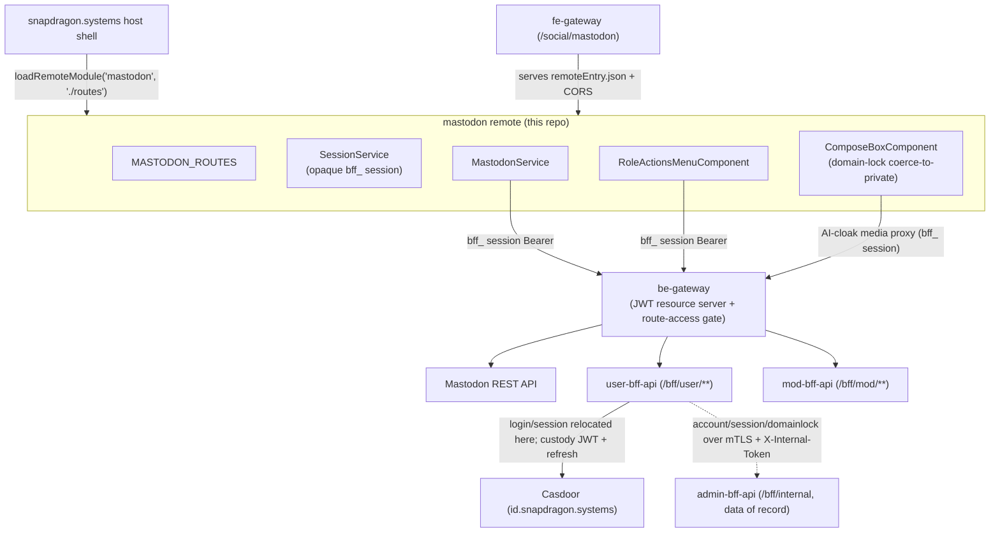

# snapdragon-mastodon-ui

The **Mastodon** Angular micro-frontend (native-federation **remote**) for the
[snapdragon.systems](https://github.com/Snapdragon-Systems/snapdragon.systems)
host shell. Federated into the host at runtime and served at `/social/mastodon`
by the `snapdragon-fe-gateway` (Spring Cloud Gateway) on the frontend Pi nodes.

Part of the Snapdragon RPi 5 / x86_64 cluster built by
[catalyst-scripts](https://github.com/Snapdragon-Systems/catalyst-scripts).
The sibling remotes live in their own repos:
[matrix/social](https://github.com/Snapdragon-Systems/snapdragon-social-ui) ·
[login](https://github.com/Snapdragon-Systems/snapdragon-login-ui) ·
[user](https://github.com/Snapdragon-Systems/snapdragon-user-ui) ·
[mod](https://github.com/Snapdragon-Systems/snapdragon-mod-ui) ·
[admin](https://github.com/Snapdragon-Systems/snapdragon-admin-ui).

## What this remote is

An Angular 22 + `@angular-architects/native-federation` single-project workspace
(project `mastodon`, root `.`, sourceRoot `src`, prefix `snap-mastodon`).

- **Remote name:** `mastodon`
- **Exposed federation module:** `./routes` → **`MASTODON_ROUTES`**
  (`src/app/mastodon.routes.ts`)

The host loads it via `loadRemoteModule('mastodon', './routes')` and mounts the
routes under `/social/mastodon`. The remote name + the `./routes` key are the
contract the host's `loadRemoteModule()` depends on — they are kept stable. The
federation surface (shared singletons, `strictVersion`, the RxJS skip list) is
centralised in `federation-base.js` (`snapdragonRemote()`), copied verbatim from
the snapdragon.systems reference so this remote can't drift from the host or the
sibling remotes; `federation.config.js` only declares the name + `exposes`.

`src/app/app.component.ts` (`snap-mastodon-root`) is a small standalone dev shell
used only when the remote runs on its own (`ng serve mastodon`); in production
the host federates `./routes` directly and the shell is not loaded.

### Architecture & data flow

The host federates `./routes`; the fe-gateway serves the remote bundle and the
remote calls the Mastodon API and the same-origin BFFs through the be-gateway,
authenticating with the shared opaque `bff_` session (see
[Auth, session & role-gate](#auth-session--role-gate)):



The browser only ever holds the **opaque `bff_` session**; the gateway's
pre-security exchange filter swaps it for the internal Casdoor custody JWT, so the
be-gateway runs its JWT validation + data-driven `gateway_route_access` gate
unchanged. The remote never sees a raw Casdoor or per-service token.

## Routes / key components

All routes are children of `MASTODON_ROUTES`, mounted by the host at
`/social/mastodon/...`:

| Path | Component | Notes |
| --- | --- | --- |
| `''`, `home` | `MastodonTimelineComponent` | home timeline + top composer |
| `local` | `MastodonTimelineComponent` | `data.source: community` (local public) |
| `public` | `MastodonTimelineComponent` | federated public |
| `tags/:tag` | `MastodonTimelineComponent` | hashtag timeline |
| `favourites`, `bookmarks` | `MastodonTimelineComponent` | Link-header paginated |
| `lists/:id` | `MastodonTimelineComponent` | list timeline |
| `status/:id` | `StatusDetailComponent` | single status + ancestor/descendant context |
| `account/:acct` | `AccountProfileComponent` | profile + that account's statuses |
| `notifications` | `NotificationsColumnComponent` | |
| `search` | `SearchComponent` | accounts / statuses / hashtags |
| `explore` | `ExploreComponent` | trending statuses / tags / links |
| `direct` | `ConversationsColumnComponent` | DM conversations |
| `lists` | `ListsIndexComponent` | the caller's lists |

The single `MastodonTimelineComponent` shell is reused across home / local /
public / hashtag / list / favourites / bookmarks via the route's `data.source`
(and the `:tag` / `:id` params). Supporting components: `TootCardComponent`
(status card — reply/boost/favourite/bookmark, CW expand, media, embedded
`PollComponent`), `ComposeBoxComponent` (composer / inline reply), and the two
role/preference surfaces below (`RoleActionsMenuComponent`,
`AppearancePanelComponent`).

Remote/federated HTML (toot content via `safeContent()`, profile bio + fields via
`safe()`) is rendered through Angular's `[innerHTML]` binding **with the built-in
sanitizer left on** — these helpers return the raw string and never call
`bypassSecurityTrustHtml`, so injected `<script>` / `on*` handlers / `javascript:`
URLs are stripped while safe formatting markup is kept (stored/DOM XSS, A03 /
CWE-79). ✅ shipped.

`MastodonService` (`src/app/mastodon.service.ts`) is a thin, typed wrapper over
the Mastodon REST API (timelines, statuses + context, post/favourite/reblog/
bookmark, polls, media, notifications, accounts + relationships, search,
favourites/bookmarks, lists, conversations, trends). The Mastodon instance base
URL is the runtime global `__SNAP_MASTODON_URL__` (default
`https://mastodon.snapdragon.systems`), reached via the be-gateway.

## Auth, session & role-gate

Login/registration are delegated entirely to **Casdoor** (`id.snapdragon.systems`):
the **login** remote drives a Casdoor OIDC authorization-code (PKCE) redirect, and
**`snapdragon-user-bff-api`** performs the server-side code→token exchange and
holds the per-session Casdoor JWT custody + refresh. The browser — and therefore
this remote — only ever holds an **opaque `bff_`-prefixed session**; the user
never sees their own Casdoor JWT, and there is no per-service Mastodon token in
the browser. This remote never renders a login form.

- `MastodonService` and the BFF services attach the shared opaque `bff_` session
  as the Bearer; the be-gateway's pre-security exchange filter swaps `bff_` for
  the internal custody JWT before its JWT validation + `gateway_route_access`
  role gate run, so the gateway is a pure Casdoor-JWT resource server downstream.
- The host injects nothing service-specific; a host may still call
  `setAccessToken()` only as a standalone-dev override.

> Auth-core extraction is complete: user-bff performs the OIDC
> authorization-code→token exchange and holds the per-session Casdoor custody JWT
> + refresh. The account/session **data of record** lives in `admin-bff-db`;
> user-bff reaches it via `admin-bff` `/bff/internal` over mTLS +
> `X-Internal-Token`. The shared `snapdragon-auth-core` Maven artifact carries the
> common session/MFA/Casdoor-admin infrastructure. This remote only ever talks to
> the be-gateway and is unaffected by where the BFF logic lives.

`SessionService` (`src/app/session.service.ts`) is the canonical Snapdragon
session store. It holds the `SnapSession` and derives the Casdoor role tiers as
signals — `isUser` (any authed user), `isMod` (`mod` **or** `admin`), `isAdmin`
(`admin` only) — plus `fullyRegistered`. Each remote and the host hold their own
`SessionService` over the same shared session and re-read on a same-document
broadcast / cross-tab `storage` event, so completing registration in the login
remote unlocks the host shell's social nav.

These role signals are **defence-in-depth**: the bff-apis enforce
`ROLE_USER`/`MOD`/`ADMIN` server-side (and the gateway runs the data-driven
`gateway_route_access` gate — ADMIN/GAME-MASTER bypass within own domain,
SUPERADMIN cross-domain), and the UI simply never shows an option the role can't
use. The additive tiers preserve the invariant that a MOD never sees the ADMIN
tier and a USER never sees the MOD/ADMIN tier.

### Role-tiered action surface

`RoleActionsMenuComponent` (`snap-mastodon-role-actions`, mounted from
`TootCardComponent` and `AccountProfileComponent`) is one reusable menu that
renders three additive tiers off the session role signals:

- **USER** (`isUser`): self-block a Mastodon/internal account
  (`POST/DELETE /bff/user/blocks`) and recommend an instance block to mods
  (`POST /bff/user/recommend-instance-block`) — via `UserBffService`.
- **MOD** (`isMod`): server-wide block of a user/instance
  (`POST /bff/mod/block`) and triage of the moderation queue
  (`GET /bff/mod/moderation`) with refer-to-admin
  (`POST /bff/mod/moderation/{id}/refer`) — via `ModBffService`.
- **ADMIN** (`isAdmin`): approve/deny a moderation request is **rendered but
  STUBBED** — `admin-bff-api` exposes no matching endpoint, so it makes no
  network call and discloses the stub honestly; the full Mastodon admin console
  lives in `snapdragon-admin-ui` by design.

### SOCIAL local-only / domain-lock ✅ shipped

When an admin/mod domain-locks an account, the homeserver's **force-local MRF is
the actual enforcer** — the UI is honest defence-in-depth on top of it, never the
source of truth.

`SessionService.mastodonDomainLocked` is a computed signal off a
`MASTODON_DOMAINLOCKED` role marker that the BFF tier forwards (domainlock
pass-through; the account/domainlock data of record lives in `admin-bff-db`,
surfaced into the session via the user-bff/gateway path). The marker is
normalised before it is read: a `ROLE_MASTODON_DOMAINLOCKED` / mixed-case variant
is lowercased to `mastodon_domainlocked` (the same reserved-prefix-aware folding
the rest of the session roles use), so the lock survives prefix/case differences
across BFFs.

In `ComposeBoxComponent`, a domain-locked user (`domainLocked()` true):

- has the **federated-reach visibilities** (`public`, `unlisted`) disabled +
  helptext'd in the visibility picker, with the local-only indicator shown as
  enforced (`aria-disabled` so it stays focusable, not natively `disabled`);
- has the bound visibility **coerced down to `private`** in `ngDoCheck` if it is
  ever a federated value (e.g. a `defaultVisibility` Input, or a cross-tab lock
  that lands after the composer opened), and **again at `submit()`** as a second
  defence-in-depth layer even if the bound value was somehow set past the
  disabled UI.

The non-locked case is left honest too: a per-post local-only toggle is *not*
wired (no per-post local-only flag on the homeserver yet), so the control shows
"not available yet" copy rather than pretending to work.

## BFFs & multi-tenancy

The remote talks to two same-origin BFFs that the fe-gateway proxies (base
overridable via `__SNAP_BFF_URL__`, default same origin):

- `UserBffService` → `/bff/user/**` (snapdragon-user-bff-api): self-blocks +
  instance-block recommendation. The user-bff-api forces `owner = JWT subject`,
  so a user only ever sees/edits their own rows.
- `ModBffService` → `/bff/mod/**` (snapdragon-mod-bff-api): the moderation queue
  + server-wide block, gated server-side by `hasAnyRole('MOD','ADMIN')`.

Both follow the Snapdragon datastore pattern (RxJS `BehaviorSubject`-backed,
single source of truth) and attach the shared opaque `bff_` session as the
Bearer. Because the gateway resolves the BFF target per request and the BFFs key
every row to the authenticated JWT subject (issuer-keyed domain scoping), the
same federated bundle serves every brand/tenant — the remote carries no
per-tenant config.

### AI-cloak media (poison-before-ingest)

When the composer uploads an **image** with the per-user AI-cloak preference ON,
it routes the file through the BFF media proxy
(`POST /bff/user/media/upload`, authed with the `bff_` session) so the bytes are
Glaze/Nightshade-style perturbed **before** the homeserver ingests / re-encodes /
federates them — a direct `/api/v2/media` upload would let the clean original
federate first. The BFF returns the homeserver `MediaAttachment` exactly as a
direct upload would (downstream `submit()` / `media_ids` is untouched) plus a
server-owned `cloak` decision.

The composer queries `GET /bff/user/media/capability` on open to render an honest
shield state up front, polls `GET /bff/user/media/status/{ref}` so the
per-attachment badge flips `pending → protected/degraded`, and offers a "post now
without protection" escape hatch. The copy is deliberately honest: it never
claims "protected" for a `degraded`/`skipped`/`unavailable`/`failed` outcome, and
warns-before-post when the heavy worker tier is absent (e.g. Pi5-only cluster).

## Appearance / style preferences

Every signed-in user (user / mod / admin) can customise **their own** look from
the timeline-header gear (`AppearancePanelComponent`, modelled on the spirit of
TangerineUI for Mastodon — no CSS copied): colour theme + accent,
light/dark/auto, single vs multi column, density, media corners, font family
(incl. a dyslexia-friendly option), text size, plus high-contrast and
reduced-motion toggles.

`PreferencesService` is the single source of truth: each change flows through one
`persist()` chokepoint, is saved to a versioned localStorage key
(`snap.mastodon.prefs.v1`), and is applied as `data-*` attributes + CSS custom
properties **scoped to this remote's own root** (`.snap-mastodon` /
`snap-mastodon-root`) so it never leaks onto the host or sibling remotes. OS
`prefers-reduced-motion` / `prefers-contrast` are honoured on first load. An
ADMIN-only "set as the default for everyone" control writes the org default that
non-customised users inherit — honestly local/asset-backed for now
(`assets/mastodon-appearance-default.json` + a per-browser override), with the
durable `/bff/user/preferences` and admin-bff org-default hooks documented in the
service.

## Accessibility conventions

The remote follows the cross-repo Snapdragon a11y standard (baseline copied into
`src/styles.scss`), so it is accessible standalone and consistent when federated:

- The `.sr` screen-reader-only helper carries text labels alongside icon-only
  controls; decorative emoji/icons are `aria-hidden="true"`.
- Async results announce through live regions — `role="status"`/`aria-live`
  (`polite`) for normal updates, `role="alert"`/`assertive` for errors; the
  appearance panel and role-actions menu announce each applied change.
- Toggle controls expose state via `aria-pressed` / `aria-expanded`; pop-over
  panels trap focus on open, restore it to the trigger on close, and close on
  `Escape`.
- Composer fields use unique `<label for>` bindings (per-instance id prefixes so
  inline reply composers stay unique) and a live character counter.
- WCAG-AA/AAA `--sd-*` colour tokens, a touch-target minimum, and a
  reduced-motion media query are baked into the baseline styles.
- Full **keyboard operability** ✅ shipped: native buttons/inputs/selects
  throughout; the account-profile tabs are a WAI-ARIA `tablist` with a roving
  `tabindex` driven by `ArrowLeft` / `ArrowRight` / `Home` / `End`
  (`onTabKeydown`); the compose "Attach media" file input is visually hidden but
  kept **in the tab order** (`.sr`, not `hidden`) so it stays focusable; and the
  dev shell provides a skip link to a focusable `<main>` landmark, backed by a
  global `:focus-visible` ring.

## Current State

- **Stack:** Angular 22 + `@angular-architects/native-federation` 22; native-
  federation **remote** `mastodon` exposing `./routes` → `MASTODON_ROUTES`,
  federated by the host shell at `/social/mastodon`. Requires Node `^22.22.3 || ^24.15.0 || >=26.0.0` (Angular CLI 22 engine constraint).
- **Optional service:** this remote is the UI for the **akkoma/Mastodon** optional
  service. It degrades gracefully (greyed-out / honest "not available" copy) when
  the homeserver, the worker tier, or a backing BFF endpoint is absent.
- **Auth:** Casdoor SSO via the login remote (OIDC authorization-code + PKCE);
  user-bff does the server-side token exchange and holds the per-session Casdoor
  JWT. The browser holds only the **opaque `bff_` session**; the be-gateway is a
  pure Casdoor-JWT resource server with a `bff_`→custody-JWT exchange filter and a
  data-driven `gateway_route_access` role gate. The remote renders no login form.
- **Shipped:** native-federation remote + UI standard adoption; full route surface
  over a typed `MastodonService`; sanitizer-on XSS hardening (no
  `bypassSecurityTrustHtml`); USER/MOD/ADMIN role-tiered action surface (ADMIN
  approve/deny honestly stubbed); SOCIAL local-only / domain-lock coerce-to-
  private in the composer; AI-cloak poison-before-ingest media proxy; per-user
  appearance/style preferences with ADMIN org-default; cross-repo a11y baseline +
  full keyboard operability; 60-second notification polling in
  `NotificationsColumnComponent` ✅ shipped; baseline nginx HTTP security headers
  (nosniff / X-Frame-Options DENY / Referrer-Policy / HSTS + a `'self'` CSP XSS
  backstop); Playwright + BDD/Gherkin e2e harness (ships dark);
  GitLab CI build+push + OWASP pentest stage (SCA + authenticated ZAP/nuclei
  baseline).
- **CI/CD:** **GitLab only** (no GitHub Actions — the GitHub repo is pull-mirrored
  into in-cluster GitLab). `.gitlab-ci.yml` builds + pushes the nginx image to the
  in-cluster registry and `include`s the centralized generator pentest templates;
  deployed to `snapdragon-frontend` and fronted by the fe-gateway. ArgoCD GitOps.

## Roadmap

UI-touching items from the platform roadmap that land in this remote when the
backing work ships (this remote stays a thin BFF/gateway client — most of these
are gated on a new BFF endpoint or homeserver capability, not on this repo):

- **SSO end-to-end live + e2e:** flip the e2e harness green against a live
  Casdoor→user-bff→gateway path once the opaque-`bff_` session is wired through
  the gateway for the social routes.
- **MFA (WebAuthn + TOTP + recovery):** surface step-up challenges where a
  privileged Mastodon action requires it; per-role defaults are enforced upstream
  (login remote / user-bff), not here.
- **Durable preferences + org default:** move appearance prefs from the versioned
  localStorage key onto `/bff/user/preferences` and the admin-bff org-default hook
  (already stubbed in `PreferencesService`).
- **ADMIN moderation approve/deny:** wire the currently-stubbed ADMIN tier once
  `admin-bff-api` exposes the matching endpoint (full console stays in admin-ui).
- **Per-post local-only toggle:** wire the non-locked composer toggle once the
  homeserver advertises a per-post local-only flag.
- **A/V is LAN-only today:** no TURN/SFU yet; federated audio/video reach is
  blocked on the platform coturn/TURN work.
- ✅ **SSE real-time PLATFORM notifications — already covered by the host shell
  (no code needed in this remote).** `GET /bff/user/notifications/events`
  (user-bff-api `main`, PR #72) and the host-shell `NotificationToastService`
  toast (`snapdragon.systems` `main`, PR #104) are both merged. Because this
  remote is a **routed, chrome-less native-federation remote** mounted inside
  `snapdragon.systems`' persistent `AppComponent` (`RouterOutlet` +
  `NotificationToastComponent` live at the host's app-root, wrapping every
  route including `/social/mastodon/**`), the host's toast already fires while
  browsing this remote — there is no separate chrome here to host a second
  toast overlay in, and adding one would double-fire every event. **No action
  needed in this repo.**

  Note this is a DIFFERENT notification domain than
  `NotificationsColumnComponent` below: the platform SSE stream carries the
  four `user_notifications` categories (`account-restriction`, `role-change`,
  `infra-impacting`, `feature-availability`) — never Mastodon-native
  mentions/boosts/favourites/follows, which stay on `NotificationsColumnComponent`'s
  own homeserver-backed polling feed (see Shipped, above). Mastodon/Akkoma's
  own native WebSocket streaming API (`/api/v1/streaming`) — a real-time push
  for the *social* notification feed itself — remains a SEPARATE, unstarted
  🔭 planned item, distinct from the platform SSE stream this bullet is about.

## Develop

```bash
npm install
npm start                 # ng serve mastodon — the dev shell on :4202
npm run build             # build the remote → dist/mastodon/browser
npm run build:mastodon    # same (explicit alias)
npm test                  # ng test mastodon (ChromeHeadlessCI, single run)
```

The application builder nests output under `dist/mastodon/browser/`, including
`remoteEntry.json` (the federation manifest that exposes `./routes`). Angular CLI
22 requires Node `^22.22.3 || ^24.15.0 || >=26.0.0` (from the `@angular/cli` engines field).

## Deploy

`Dockerfile` builds the remote and serves `dist/mastodon/browser` via nginx
**with CORS** (the host fetches `remoteEntry.json` cross-origin) and a baseline
set of **HTTP security headers** (see below); `/healthz` returns `200`.
`.gitlab-ci.yml` builds + pushes the image to the in-cluster GitLab registry (the
GitHub repo is pull-mirrored into in-cluster GitLab). The image is deployed to
the `snapdragon-frontend` namespace and fronted by the fe-gateway at
`/social/mastodon`.

### nginx security headers ✅ shipped

`nginx.conf` emits defence-in-depth HTTP security headers on every response
(`always`, so error responses are covered too), tuned to be inspection-safe for
an Angular SPA + module-federation remotes + OAuth redirect flows:

- `X-Content-Type-Options: nosniff` — stop MIME-type sniffing.
- `X-Frame-Options: DENY` — clickjacking protection (the SPA is never framed;
  module federation loads remotes via `<script>`, not iframes).
- `Referrer-Policy: strict-origin-when-cross-origin` — don't leak full URLs
  cross-origin.
- `Strict-Transport-Security: max-age=31536000; includeSubDomains` — pin HTTPS
  for a year incl. subdomains (only affects HTTPS responses).
- `Content-Security-Policy: default-src 'self'; script-src 'self'; object-src
  'none'; base-uri 'self'` on the SPA `location /` — an XSS backstop that stops
  any injected inline/remote script from executing, on top of the sanitizer-on
  rendering. Because nginx `add_header` does **not** merge across blocks, the
  server-scope headers are repeated in each `location` (`/`, `/healthz`) that
  sets its own header, so they keep covering those responses.

Stricter policies (COEP/CORP, `Permissions-Policy`) are deliberately deferred —
they need per-UI tuning + browser validation in the live-cluster pass.

### OWASP pen-test stage ✅ shipped

`.gitlab-ci.yml` declares two stages — `build` and `pentest` — and `include`s the
centralized OWASP pen-test templates from the generator
(`Snapdragon-Systems/snapdragon-generator @ main`,
`/tests/pentest/ci/pentest-stage.gitlab-ci.yml`), so this repo rides the one
source of truth rather than carrying its own scanner config:

- `pentest:sca` extends `.pentest-sca` — Dependency-Check SCA over this repo's
  checkout.
- `pentest:dast` extends `.pentest-dast-baseline` — an authenticated ZAP baseline
  (spider + passive + probes + nuclei) via the shared harness against a spun-up
  env-test-build.

Both run on merge requests and the default branch and are `allow_failure: true`,
so a finding reports without breaking the image build. `make pentest`
(`pentest-sca` + `pentest-dast`) runs the same self-scan locally, mirroring the CI
stage (SCA via `npm audit` locally / Dependency-Check in CI; DAST via the shared
harness when `DAST_TARGET_URL` is set).
